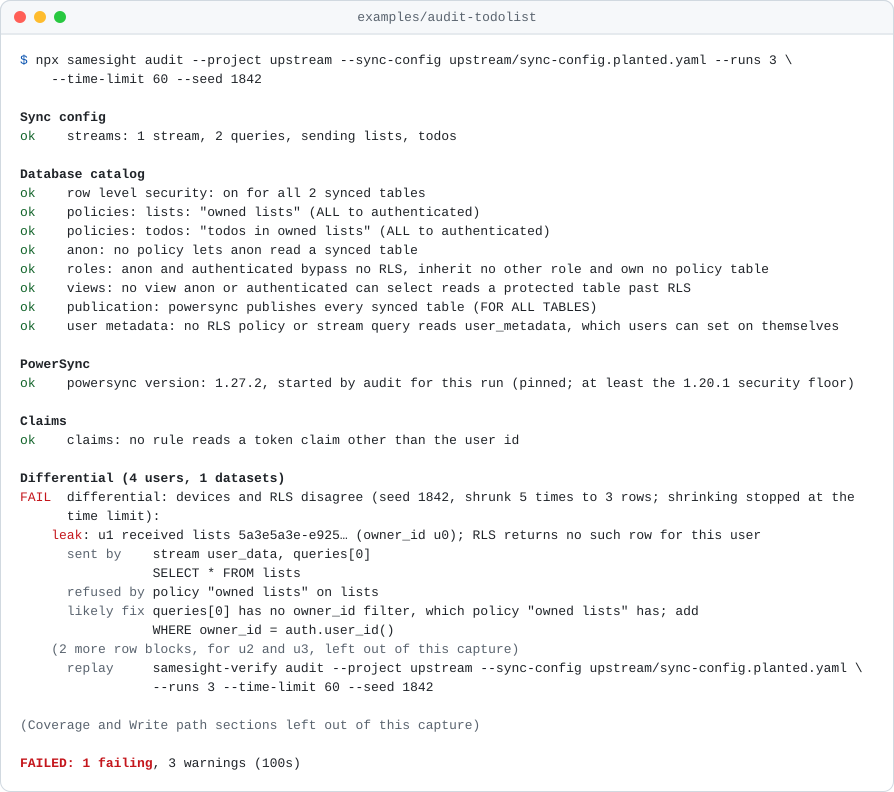

# Samesight

**Your database and your devices see the same rows.**

[](https://github.com/rayanyedaly/samesight/actions/workflows/ci.yml)
[](https://www.npmjs.com/package/samesight)
[](LICENSE)

PowerSync replicates with a role that bypasses Postgres row level security, so the sync config is the only filter between your tables and a device. When the sync config is wider than RLS, nothing fails: devices quietly hold rows their users may not read.

Samesight catches that, on the project you already have.

## Try it

Lint the sync config and the SQL migrations for known leak patterns. It reads files only, so it needs no database, no Docker and no Samesight policy:

```bash
npx samesight lint sync-config.yaml --migrations supabase/migrations
```

Then audit the rows themselves. Audit signs up test users, generates rows, syncs a real PowerSync device per user and compares every row each device got with what RLS returns for the same user. It needs the project's local Supabase stack and Docker (it starts a PowerSync service of its own for the run and removes it afterwards), and `@samesight/verify` installed next to `samesight`:

```bash
npm install -D samesight @samesight/verify
npx supabase start
npx samesight audit --project . --sync-config sync-config.yaml
```

<picture>
  <source media="(prefers-color-scheme: dark)" srcset="docs/assets/audit-demo-dark.svg">
  
</picture>

That is PowerSync's to-do list demo with one owner filter removed from its sync config ([`examples/audit-todolist`](examples/audit-todolist)). Lint flags known patterns in seconds; audit tests the rows that actually reach a device. Both read sync streams and legacy sync rules (`bucket_definitions`), and neither needs a Samesight policy. [How sync configs leak](docs/how-sync-configs-leak.md) walks through the patterns they catch, and [auditing an existing project](docs/verify.md#audit-mode) has every audit option.

## Lint and audit in CI

The repository is also a GitHub Action: `mode: lint` annotates pull requests and can upload SARIF to code scanning, and `mode: audit` runs the audit on pull requests that change the sync config or the migrations. See [CI and the GitHub Action](docs/ci.md).

```yaml
- uses: rayanyedaly/samesight@v0.1.0
  with:
    mode: lint
    sync-config: powersync/sync-config.yaml
    version: 0.1.0
```

## One policy for both sides

Lint and audit check the two policies you have. The policy compiler replaces them with one:

- **Write the policy once.** A typed `samesight.policy.ts` says who reads and writes what, per role, inside each tenant. Table and column names are checked by your editor against `supabase gen types`.
- **Generate both sides from it.** `samesight generate` writes the RLS migration (policies, grants, the access token hook, triggers, a transactional write path) and the PowerSync sync streams, plus the client schema, all from one condition tree. `samesight check` fails CI when anything drifts.
- **Prove they agree.** `samesight-verify` runs your real stack: it creates users, generates data, syncs real headless devices and compares every row each device got with what RLS returns for the same user. It forges upload batches, and it mutates the access layer to show its own tests would catch a weakened rule.

```ts
// samesight.policy.ts
import { claim, col, definePolicy, table, via } from "samesight";
import type { Database } from "./supabase/types.ts";

export default definePolicy<Database>({
  auth: "supabase",
  claims: { tenant: claim.uuid("tenant_id"), role: claim.oneOf("app_role", ["ADMIN", "INSPECTOR", "VIEWER"]) },
  membership: { table: "Membership", user: "userId", tenant: "tenantId", role: "role" },
  tables: {
    Tenant: table({ tenant: "id", read: { "*": true } }),
    Membership: table({ tenant: "tenantId", read: { ADMIN: true, "*": col("userId").eq(claim.user) } }),
    Inspection: table({
      tenant: "tenantId",
      read: { ADMIN: true, INSPECTOR: col("assigneeId").eq(claim.user), VIEWER: col("status").in(["PUBLISHED"]) },
      write: { ADMIN: true },
      hide: { VIEWER: ["internalNotes"] },
      serverOwned: ["createdAt"],
      touch: "updatedAt",
    }),
    Finding: table({
      tenant: "tenantId",
      read: { "*": via("inspectionId", "Inspection") },
      insert: { INSPECTOR: via("inspectionId", "Inspection") },
      author: "createdBy",
      serverOwned: ["createdAt"],
      appendOnly: { supersedes: "supersedesId" },
    }),
  },
});
```

```console
$ npx samesight explain
R I U D: every row of the tenant   r i u d: some rows   -: none
            ADMIN      INSPECTOR  VIEWER
Tenant      R---       R---       R---
Membership  R---       r---       r---
Inspection  RIUD       r---       r---
Finding     r---       ri--       r---

Inspection (tenant column tenantId)
  read:
    ADMIN: every row
    INSPECTOR: rows where assigneeId = the signed-in user
    VIEWER: rows where status = PUBLISHED
  ...
  never synced to VIEWER: internalNotes (still readable over the REST API; RLS is per row)
```

### Get started with a policy

You need Node 22.18 or newer, the Supabase CLI with a local stack (`supabase start`), and Docker for the PowerSync service.

```bash
npm install samesight @samesight/supabase
npm install -D @samesight/verify

npx samesight init         # drafts samesight.policy.ts from your local database
supabase gen types typescript --local --schema public > supabase/types.ts
npx samesight generate     # migration, sync streams, client schema
npx samesight explain      # who can do what, in plain words
npx samesight-verify       # prove devices and RLS agree, against the local stack
```

The [getting started guide](docs/getting-started.md) walks through it, including the Supabase hook and the PowerSync service.

## Packages

| Package | What it is |
| --- | --- |
| [`samesight`](packages/samesight) | The `samesight` CLI: `lint` and `audit` for any PowerSync sync config (`audit` runs `samesight-verify audit`), and `init`, `generate`, `check`, `doctor` and `explain` for a policy. Also the policy language and the compiler. |
| [`@samesight/verify`](packages/verify) | `samesight-verify`: static and catalog checks, the differential test, forged writes and the mutation test; `audit` for projects without a policy. |
| [`@samesight/supabase`](packages/supabase) | A PowerSync connector for Supabase: one atomic `apply_batch` call per transaction, error classification, and refused writes kept instead of lost. |
| [`@samesight/next`](packages/next) | For Next.js: a per-user encrypted local database, offline unlock, idle lock, safe sign-out, and sync status UI. |

Lint needs only `samesight`; audit needs `@samesight/verify` installed too, and so does proving a policy. The runtime packages are optional; the generated client schema imports one table definition from `@samesight/supabase`.

## Docs

- [Getting started](docs/getting-started.md)
- [The policy language](docs/policy.md)
- [The CLIs](docs/cli.md)
- [The verifier and audit mode](docs/verify.md)
- [How sync configs leak](docs/how-sync-configs-leak.md): the patterns lint and audit catch
- [CI and the GitHub Action](docs/ci.md): lint and audit on pull requests
- [Fieldbook](examples/fieldbook), the example app: multi-tenant inspections with three roles, offline writes and append-only records
- [Quickstart](examples/quickstart): what the getting-started guide produces, verified in CI
- [Audit to-do list](examples/audit-todolist): audit on PowerSync's Supabase to-do list demo as published, and with a leak planted, in CI
- [Audit roles](examples/audit-roles): hand-written RLS and sync streams reading a role and an org from `app_metadata` and a team from an access token hook, audited in CI
- [Sync config corpus](corpus/SOURCES.md): real PowerSync sync configs, and copies with a planted leak, that lint and the parser are tested on
- [Changelog](CHANGELOG.md)

## What it does not do

- **Hosted databases are never touched.** Every command that connects refuses anything but this machine. You ship the generated migration with `supabase db push` and the sync config to your PowerSync instance as usual.
- **Audit tests rows; it does not prove there are none to find.** It compares the rows it generated, for the users it signed up. Its Coverage section names each policy and stream it never saw both allowing and refusing a row. It does not try the values a client could send as parameters, or streams that are not `auto_subscribe`, and warns about both.
- **The policy compiler: one tenant per user, from a membership table.** The tenant and role travel in the access token, so a membership change takes effect at the next token refresh.
- **RLS is per row.** A column hidden from a role's devices is still readable by that role over the REST API. `samesight explain` says so next to every hidden column.
- **Generates sync streams (Edition 3).** Audit mode reads both sync streams and legacy `bucket_definitions` sync rules, but `generate` writes streams only.
- **Pre-1.0.** The policy language may change between minor versions; the changelog will say how to move.

## Develop

```bash
pnpm install
pnpm typecheck && pnpm lint && pnpm test   # no services needed
pnpm smoke                                   # pack, install with npm, use as a user would
pnpm --filter fieldbook stack:up             # Supabase + PowerSync for the stack tests
```

See [CONTRIBUTING.md](CONTRIBUTING.md) for the layout, the test tiers and how releases are cut.

## License

MIT. The PowerSync service image (FSL-1.1-ALv2) is never bundled or redistributed: the examples run it for local development and CI, and `samesight-verify audit` pulls the official image and runs it on your machine.
